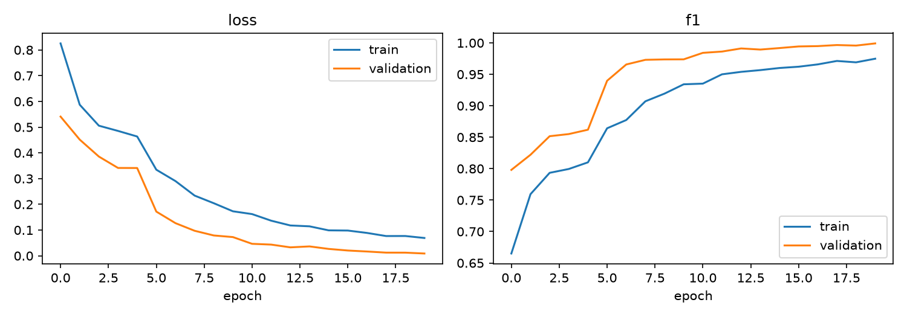
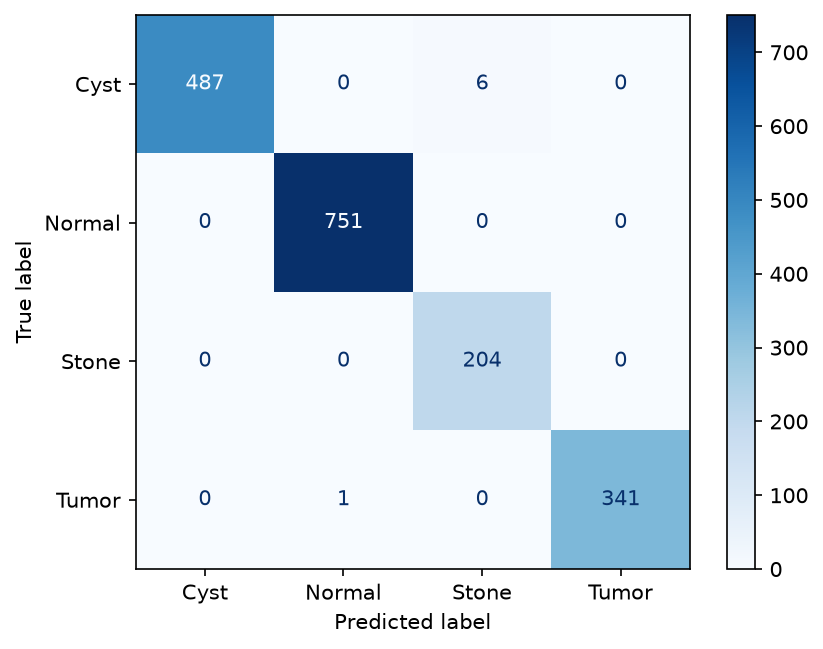
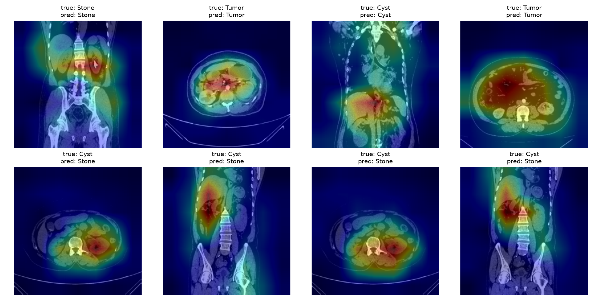

# Kidney Disease Classification from CT Scans

Deep learning project that classifies kidney CT images into four categories: **Normal, Cyst, Tumor, and Stone**. It fine-tunes a pretrained EfficientNet-B0 with two-stage transfer learning, evaluates it with medical-relevant metrics, explains predictions with Grad-CAM, and serves the model through a small FastAPI app packaged with Docker.

> **Disclaimer:** This project is for educational purposes only. It is not a medical device and must not be used for diagnosis or treatment decisions.

---

## Table of Contents
- [Overview](#overview)
- [Dataset](#dataset)
- [Approach](#approach)
- [Results](#results)
- [Project Structure](#project-structure)
- [Getting Started](#getting-started)
- [Limitations](#limitations)
- [Tech Stack](#tech-stack)
- [Acknowledgements](#acknowledgements)

---

## Overview

Kidney conditions such as cysts, stones, and tumors can look similar on CT slices, and early identification matters. This project builds an image classifier that predicts which of four classes a CT slice belongs to, and shows *where* in the image the model is looking.

**Highlights**
- Two-stage transfer learning (train the new head, then fine-tune the top backbone blocks) on a pretrained EfficientNet-B0
- Class-weighted loss to handle class imbalance
- Mixed-precision (AMP) training, tuned for a consumer GPU (RTX 3050)
- Evaluation with per-class precision, recall, F1, macro-F1, and a confusion matrix
- Grad-CAM heatmaps for model explainability
- Single self-contained notebook for data preparation, training, and evaluation
- FastAPI inference API with a separate Streamlit upload frontend

---

## Dataset

**CT Kidney Dataset: Normal, Cyst, Tumor and Stone** (Kaggle), about 12.4k CT images in four classes.

| Class | Description |
|---|---|
| Normal | Healthy kidney |
| Cyst | Fluid-filled sac |
| Stone | Kidney stone |
| Tumor | Abnormal growth |

**Preparation**
1. Removed exact duplicate images (MD5 hash).
2. Stratified split into **70% train / 15% validation / 15% test** with a fixed random seed.
3. The test set is used **once**, for final evaluation only.

Download the dataset from Kaggle and place it in a `data/` folder (see [Getting Started](#getting-started)). The dataset is not included in this repository.

---

## Approach

### Model
- **Backbone:** EfficientNet-B0 pretrained on ImageNet (via `torchvision`)
- **Head:** new classifier layer with 4 outputs
- **Input:** 224 x 224 RGB, normalized with ImageNet mean and standard deviation

### Training (two stages)
| Stage | Trainable parts | Epochs | Learning rate |
|---|---|---|---|
| 1. Feature extraction | New head only (backbone frozen) | ~5 | ~1e-3 |
| 2. Fine-tuning | Head + last backbone blocks | ~10-15 | ~1e-4 (head), ~1e-5 (backbone) |

- **Loss:** cross-entropy with class weights
- **Optimizer:** AdamW with weight decay
- **Augmentation (train only):** horizontal flip, small rotations, brightness/contrast jitter
- **Regularization:** early stopping on validation macro-F1; best checkpoint is saved
- **Speed:** mixed precision (AMP) on CUDA

### Evaluation
Computed on the held-out test set:
- Accuracy
- Per-class precision, recall, and F1
- **Macro-F1** (headline metric)
- Confusion matrix
- Grad-CAM visualizations on correct and incorrect predictions

---

## Results


| Metric | Value |
|---|---|
| Test accuracy | XX.X% |
| Macro-F1 | 0.XXX |

**Per-class results**

| Class | Precision | Recall | F1 |
|---|---|---|---|
| Normal | 0.XX | 0.XX | 0.XX |
| Cyst | 0.XX | 0.XX | 0.XX |
| Stone | 0.XX | 0.XX | 0.XX |
| Tumor | 0.XX | 0.XX | 0.XX |

**Training curves**



**Confusion matrix**



**Grad-CAM examples**



---

## Project Structure

```text
kidney-classifier/
├── kidney_classification_1.ipynb   # data preparation, training, evaluation, Grad-CAM
├── api.py                          # FastAPI inference API
├── app.py                # Streamlit frontend
├── model/
│   ├── .gitkeep
│   └── model.pt                    # trained weights created by the notebook
├── requirements.txt                # all project dependencies
├── Dockerfile                      # shared image for API or Streamlit
└── README.md
```

The dataset and trained checkpoint are not included. The API can start without `model/model.pt`, but predictions require a checkpoint generated by the notebook.

---

## Getting Started

### 1. Create a Python 3.12 environment

```bash
python -m venv venv
```

Activate it on Windows PowerShell:
```powershell
venv\Scripts\Activate.ps1
```

On macOS/Linux:
```bash
source venv/bin/activate
```

### 2. Install dependencies

```bash
python -m pip install --upgrade pip
pip install -r requirements.txt
```

The single `requirements.txt` contains the API, frontend, and notebook dependencies. PyTorch `2.10.0` and torchvision `0.25.0` are pinned as a matched pair for Python 3.12. For GPU training, install the CUDA build that matches your system from [pytorch.org](https://pytorch.org).

### 3. Download the dataset

Download the CT Kidney dataset from Kaggle and extract it so the class folders sit under `data/`:
```
data/
├── Normal/
├── Cyst/
├── Stone/
└── Tumor/
```

### 4. Run the notebook

Open `kidney_classification.ipynb` and run all cells from top to bottom. The notebook cleans and splits the data, trains both stages, evaluates the model, generates Grad-CAM plots, and saves the checkpoint to `model/model.pt`.

**GPU memory note:** if you hit a CUDA out-of-memory error, lower `BATCH_SIZE` in the config cell (try 16, then 8).

---

## Demo App

The project uses FastAPI for predictions and Streamlit for the interface. Both use the same environment and the single `requirements.txt` file. Start the API in one terminal:

```bash
uvicorn app:app --host 0.0.0.0 --port 8000
```

In a second terminal, activate the same environment and start Streamlit:

```bash
streamlit run streamlit_app.py
```

Open `http://localhost:8501` for the frontend. The API docs are at `http://127.0.0.1:8000/docs`. By default, Streamlit sends requests to `http://127.0.0.1:8000`; to use another backend, set `KIDNEY_API_URL` to the API's base URL before launching Streamlit.

### Docker

Build one image:

```bash
docker build -t kidney-classifier .
```

Run the API (default command):

```bash
docker run --rm -p 8000:8000 -v "${PWD}/model:/app/model:ro" kidney-classifier
```

For the Streamlit service, deploy the same image with this start command instead of the default command:

```bash
streamlit run streamlit_app.py --server.address=0.0.0.0 --server.port=${PORT:-8501}
```

Set `KIDNEY_API_URL` in the Streamlit service to the deployed API's base URL. The image uses Python 3.12 and CPU-only PyTorch wheels.

| Endpoint | Method | Description |
|---|---|---|
| `/` | GET | API information |
| `/predict` | POST | Upload a CT image, get a predicted class and class probabilities |
| `/health` | GET | Reports API and checkpoint availability |
| `/docs` | GET | Interactive API documentation |

---

## Limitations

- The dataset has **no patient identifiers**, so images from the same patient may appear in more than one split. Reported metrics may therefore be optimistic compared with performance on truly unseen patients.
- Trained on a single public dataset; performance on CT scans from other scanners or hospitals is untested.
- 2D slice classification only; it does not use 3D context across slices.
- Not clinically validated. Educational use only.

---

## Tech Stack

Python 3.12, PyTorch, torchvision, scikit-learn, NumPy, Matplotlib, FastAPI, Uvicorn, Streamlit, pandas, requests, Docker

---

## Acknowledgements

- CT Kidney Dataset (Normal, Cyst, Tumor and Stone) from Kaggle. Please credit the original dataset authors.
- EfficientNet-B0 architecture and ImageNet-pretrained weights via `torchvision`.
- Grad-CAM technique by Selvaraju et al.
